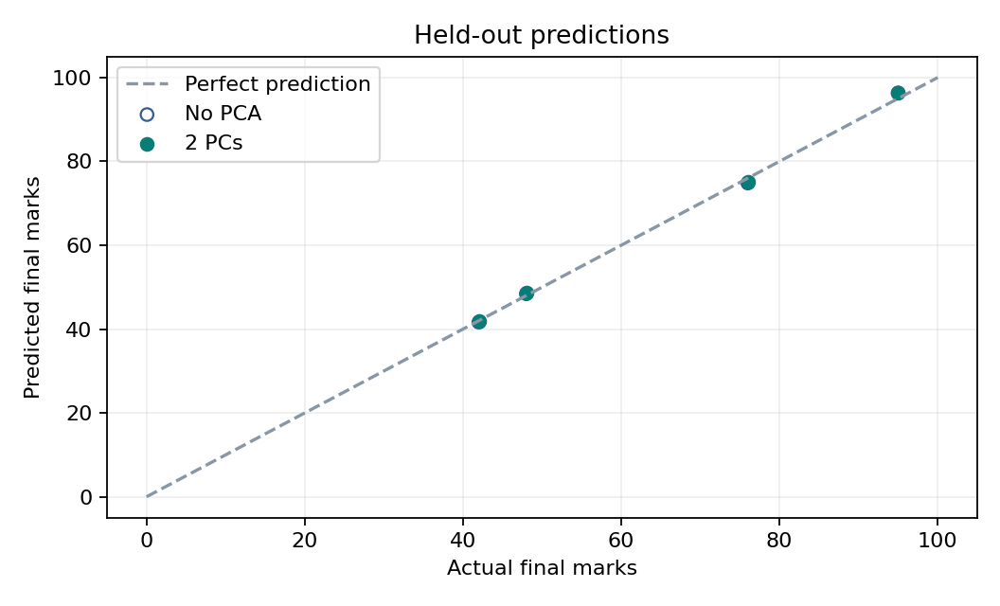
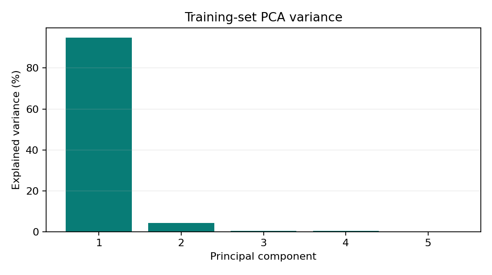

# EduPredict | Student Performance Prediction

**FY B.Tech CSE mathematics mini project** · Linear regression & principal component analysis (PCA)

**Members.**

**dev-vikul — Linear Regression**
- Regression model and student performance prediction.
- Regression coefficients and error analysis.

A local interactive mathematical laboratory that compares ordinary least-squares regression with principal component regression (PCR). Built from the original 20-record student-performance project; the original CSV is preserved. No API keys or cloud service are required.

**dev-aman — PCA**
- Feature standardization and dimensionality reduction.
- Eigenvalues and explained variance analysis.

**khushi — Data Analysis**
- Dataset preprocessing and correlation analysis.
- Model evaluation using RMSE and R².

## Quick start (Windows, PowerShell / VS Code)

Install 64-bit Python 3.11 or 3.12 and Git if not already installed. Open this folder in VS Code.

```powershell
py -3.12 -m venv .venv
.\.venv\Scripts\python.exe -m pip install -r requirements.txt
.\.venv\Scripts\python.exe app.py
```

If Python 3.11 is installed instead, use `py -3.11`. On Linux/macOS, use `python3 -m venv .venv` and `.venv/bin/python` in subsequent commands. Open **http://127.0.0.1:8501** in your browser. Stop the server with Ctrl+C. No virtual environment activation is needed.

## Real UCI dataset (recommended)

The official UCI Mathematics dataset is **not bundled** because the download was inaccessible during packaging. The app works immediately with the original synthetic CSV. On an internet-connected computer:

```powershell
.\.venv\Scripts\python.exe fetch_dataset.py
```

If that fails, download the archive from [UCI Student Performance](https://archive.ics.uci.edu/dataset/320/student+performance) and pass the downloaded ZIP (or `student-mat.csv`) to the importer:

```powershell
.\.venv\Scripts\python.exe fetch_dataset.py "C:\Users\YOUR_NAME\Downloads\student+performance.zip"
```

Restart the server. The dataset menu now contains the real mathematics data (395 rows) and a second experiment without G1/G2. The target G3 is a final grade out of 20, **not** out of 100. The original dataset instead predicts marks out of 100. Never compare raw RMSE across different grade scales as if equivalent.

### Data attribution
Paulo Cortez (2008), *Student Performance*, UCI Machine Learning Repository, DOI [10.24432/C5TG7T](https://doi.org/10.24432/C5TG7T). Licensed [CC BY 4.0](https://creativecommons.org/licenses/by/4.0/). UCI source contains two school-subject datasets; this project selects mathematics only and uses a subset of numeric columns. See dataset/README.md. No claim of real-data results is made until the importer runs and the experiment is executed.

## Dashboard

- Overview: held-out scores, baseline comparison and training CV RMSE by component count.
- Prediction lab: enter a hypothetical student record and see standardized values, PC scores, regression coefficients and predictions.
- PCA explorer: inspect explained variance and eigenvector loadings; change k from 1 to the full dimension.
- Mathematics: means, standard deviations, covariance matrix, eigenvalues and least squares equations.
- Dataset: feature correlations, provenance and a preview.

## Method

1. Split into 80% train / 20% test (seed 42).
2. Fit standardization and PCA on training data only; never fit them on the test data.
3. Compare standardized ordinary least squares to PCR with every component count.
4. Select k using shuffled five-fold training cross-validation, refitting each pipeline in each fold.
5. Report held-out MAE, MSE, RMSE and R². Test scores for other k values are exploratory; do not choose k from them.

## Reproduced original-data results

20 synthetic records: 16 train, 4 test. Training CV selects **2 PCs**; they retain **99.18%** of variance. Held-out RMSE is **0.874 marks** and R² is **0.99834**, versus baseline RMSE **0.936** and R² **0.99809**. These scores are optimistic: the data are tiny, strongly correlated, and artificial, so they do not establish real-world accuracy. With all five PCs, linear predictions are equivalent to ordinary regression up to numerical precision.





## Export fresh results / tests / notebook

```powershell
.\.venv\Scripts\python.exe student_performance.py
.\.venv\Scripts\python.exe -m unittest discover -s tests -v
```

Results for each installed dataset are written to `output/<dataset>/` (JSON, CSV and figures). Optional notebook support:

```powershell
.\.venv\Scripts\python.exe -m pip install jupyterlab
.\.venv\Scripts\python.exe -m jupyter lab
```

Open `Student_Performance.ipynb` and run all cells. Its saved outputs show the original synthetic dataset; rerun after importing UCI. The PDF report documents verified synthetic results, not hypothetical UCI scores.

## Project layout

```text
Student-Performance-Prediction/
├── app.py                       # local HTTP server
├── model.py                     # mathematical pipelines
├── student_performance.py       # command-line experiments and charts
├── fetch_dataset.py             # optional UCI import
├── web/                         # HTML, CSS, JavaScript dashboard
├── dataset/                     # original CSV + attribution
├── output/synthetic/            # validated results
├── tests/                       # unit tests
├── Student_Performance.ipynb    # executable mathematical walkthrough
├── Project_Report.pdf           # revised academic report
├── VIVA_GUIDE.md                 # student preparation
├── GITHUB_SETUP.md               # publishing instructions
└── requirements.txt
```

## Responsible use / authorship

For educational demonstration only. Do not use estimates for student ranking, grading, admission or other consequential decisions. Associations are not causal. The student should verify results, understand the mathematics, fill in their actual submission details, credit collaborators and disclose AI assistance if required by their college. Original project author details were not supplied. Dataset attribution is separate from code authorship; no third-party code license is asserted.
